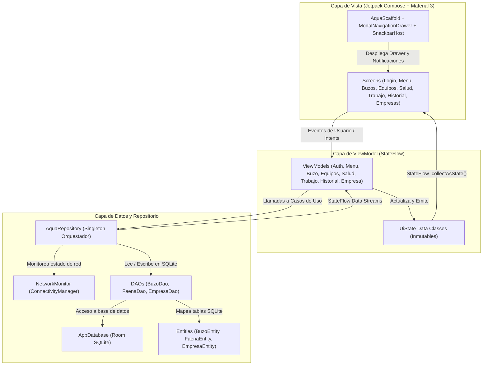
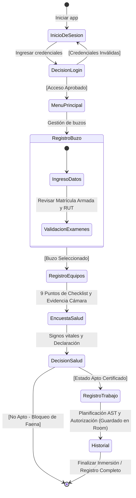

# 🌊 Aqua-Registro (MVP)
> **Proyecto de Vinculación con el Medio (VcM) — DSY1105 Desarrollo de Aplicaciones Móviles**  
> **Equipo:** Smiling Friends | **Sección:** 002D  

**Aqua-Registro** es una aplicación móvil nativa en Android diseñada para digitalizar y centralizar el pre-chequeo de seguridad de buzos comerciales en operaciones acuícolas (**AquaChile**), reemplazando los registros manuales en papel. Valida la identidad y matrícula del buzo, audita el equipamiento técnico obligatorio de buceo con evidencia fotográfica, evalúa parámetros biomédicos en la encuesta de salud pre y post inmersión, formaliza el Análisis Seguro de Trabajo (AST) para autorizar faenas submarinas y almacena todo de forma persistente y local mediante **Room (SQLite)**.

---

## 👥 Integrantes del Equipo (Smiling Friends)

| Nombre y Apellido | Rol dentro del Equipo | Responsabilidad Principal |
| :--- | :--- | :--- |
| **Cristóbal Loncón C.** | Líder de Proyecto | Coordinación general, flujo operativo, seguridad de datos y presentación |
| **Joaquín Oyarzún** | Backend & Datos | Arquitectura MVVM, Repositorio central y persistencia Room SQLite |
| **Amaro Villalobos** | FrontEnd & UI | Diseño Material Design 3, componentes Jetpack Compose y navegación |
| **Luis Villalón** | Soporte Operativo & QA | Pruebas de integración, evidencias de terreno, checklist y Trello |

---

## 📱 Funcionalidades Principales del MVP

1. **Autenticación y Registro de Prevencionistas:**
   * Validación estricta de formato y dígito verificador del RUT chileno (Módulo 11).
   * Verificación de credencial SEREMI y centro de cultivo base asignado.
2. **Enrolamiento y Gestión de Buzos (CRUD Completo):**
   * Registro con nombre, RUT, matrícula marítima DIRECTEMAR, empresa contratista y teléfono.
   * Modificación de datos y eliminación protegida (no permite borrar buzos con faenas activas).
   * Generación y selección de foto de perfil.
3. **Auditoría Técnica de Equipos de Buceo:**
   * Checklist interactivo de los 9 implementos técnicos obligatorios según normativa marítima.
   * Evidencias por etapas: *Pre-equipación* y *Equipado*.
   * **Integración con Cámara Nativa:** Captura de evidencia fotográfica del estado del equipo almacenada mediante `FileProvider`.
4. **Encuesta Biomédica de Salud Pre y Post Buceo:**
   * Evaluación de presión arterial sistólica/diastólica, frecuencia cardíaca y signos vitales.
   * Declaración jurada de condiciones físicas (descanso, sin congestión, sin medicamentos).
   * Dictamen algorítmico reactivo de aptitud médica: `APTO` o `NO_APTO`.
5. **Planificación AST y Autorización de Faenas:**
   * Registro de profundidad máxima de inmersión, tiempo de fondo y centro operativo.
   * Bloqueo estricto de inicio de faena si el buzo no cuenta con salud apta o equipos conformes.
6. **Bitácora e Historial Digital:**
   * Lista reactiva de inmersiones con buscador en tiempo real por folio, buzo o centro.
   * Filtros dinámicos por estado (*Todas*, *En Curso*, *Completada*).
   * Ficha de detalle, registro de firmas/aprobaciones digitales y cierre formal de faenas.
7. **Gestión de Empresas Contratistas:**
   * Catálogo extensible de empresas prestadoras de servicios de buceo comercial.

---

## 🏗️ Arquitectura de Software: MVVM + UDF + Room (SQLite)

La aplicación sigue fielmente la arquitectura **MVVM (Model-View-ViewModel)** recomendada oficialmente por Android y Google, garantizando desacoplamiento total y flujo unidireccional de datos (UDF):



### Componentes de la Arquitectura:
1. **Modelos de Dominio (`data.model`):**
   * [`Buzo`](MyApplication/app/src/main/java/com/example/myapplication/data/model/Buzo.kt): Entidad de dominio con matrícula DIRECTEMAR, RUT, empresa, categoría y estado de salud.
   * [`RegistroFaena`](MyApplication/app/src/main/java/com/example/myapplication/data/model/RegistroFaena.kt): Acta digital de inmersión y faena AST con control de pendientes.
   * [`EstadoSalud`](MyApplication/app/src/main/java/com/example/myapplication/data/model/EstadoSalud.kt): Enum con estados de aptitud (`APTO`, `NO_APTO`, `PENDIENTE`).
   * [`EquipoChequeo`](MyApplication/app/src/main/java/com/example/myapplication/data/model/EquipoChequeo.kt): Checklist de los implementos técnicos obligatorios de buceo.

2. **Persistencia Local con Room SQLite (`data.local`):**
   * [`AppDatabase`](MyApplication/app/src/main/java/com/example/myapplication/data/local/AppDatabase.kt): Base de datos Room (`aqua_registro.db`) con pre-poblado inteligente.
   * [`BuzoEntity`](MyApplication/app/src/main/java/com/example/myapplication/data/local/entity/BuzoEntity.kt), [`FaenaEntity`](MyApplication/app/src/main/java/com/example/myapplication/data/local/entity/FaenaEntity.kt), [`EmpresaEntity`](MyApplication/app/src/main/java/com/example/myapplication/data/local/entity/EmpresaEntity.kt): Entidades con `@Entity` y claves primarias.
   * [`BuzoDao`](MyApplication/app/src/main/java/com/example/myapplication/data/local/dao/BuzoDao.kt), [`FaenaDao`](MyApplication/app/src/main/java/com/example/myapplication/data/local/dao/FaenaDao.kt), [`EmpresaDao`](MyApplication/app/src/main/java/com/example/myapplication/data/local/dao/EmpresaDao.kt): Métodos DAO con `@Insert`, `@Query`, `@Update`, `@Delete`.

3. **Repositorio Central (`data.repository`):**
   * [`AquaRepository`](MyApplication/app/src/main/java/com/example/myapplication/data/repository/AquaRepository.kt): Orquestador Singleton que alimenta los flujos `StateFlow` reactivos de la UI mientras persiste en segundo plano en Room SQLite.

4. **ViewModels y StateFlow (`ui.viewmodels`):**
   * [`MenuViewModel`](MyApplication/app/src/main/java/com/example/myapplication/ui/viewmodels/MenuViewModel.kt): Desacopla la pantalla principal del repositorio y expone el estado de conectividad nativo.
   * [`AuthViewModel`](MyApplication/app/src/main/java/com/example/myapplication/ui/viewmodels/AuthViewModel.kt), [`BuzoViewModel`](MyApplication/app/src/main/java/com/example/myapplication/ui/viewmodels/BuzoViewModel.kt), [`EquiposViewModel`](MyApplication/app/src/main/java/com/example/myapplication/ui/viewmodels/EquiposViewModel.kt), [`SaludViewModel`](MyApplication/app/src/main/java/com/example/myapplication/ui/viewmodels/SaludViewModel.kt), [`TrabajoViewModel`](MyApplication/app/src/main/java/com/example/myapplication/ui/viewmodels/TrabajoViewModel.kt), [`HistorialViewModel`](MyApplication/app/src/main/java/com/example/myapplication/ui/viewmodels/HistorialViewModel.kt), [`EmpresaViewModel`](MyApplication/app/src/main/java/com/example/myapplication/ui/viewmodels/EmpresaViewModel.kt).

---

## 📲 Recursos Nativos del Dispositivo Integrados

Cumpliendo con el requerimiento de integrar **al menos 2 recursos nativos del dispositivo**:

| Recurso Nativo | API / Contrato Android | Permiso / Configuración | Propósito en el Negocio |
| :--- | :--- | :--- | :--- |
| **1. Cámara del Dispositivo** | `ActivityResultContracts.TakePicture()` | `FileProvider` con autoridad `${applicationId}.fileprovider` | Captura de evidencia fotográfica en terreno del estado de los equipos de buceo (traje, manorreductor, BCD, tanque). |
| **2. Conectividad de Red** | `ConnectivityManager` + `NetworkCapabilities` | `<uses-permission android:name="android.permission.ACCESS_NETWORK_STATE" />` | Monitoreo reactivo de señal de red. Notifica en la UI si el prevencionista está *En Línea* o en *Modo Terreno Offline* (apoyado en la persistencia local Room SQLite en zonas marítimas remotas). |

---

## 🎨 Identidad Visual (Material Design 3)
* **Principal:** Azul Claro (`#0099FF`) — Barras superiores, botones primarios y branding institucional AquaChile.
* **Secundario:** Verde Agua (`#00CCCC`) — Acentos marinos y botones de acción afirmativa.
* **Fondo:** Blanco Hielo (`#F6F9FD`) — Reducción de fatiga visual bajo la luz solar marina en cubierta.
* **Texto:** Slate Oscuro (`#111827`) — Máxima legibilidad y contraste.
* **Seguridad:** Verde Éxito (`#16A34A`) para *Apto / Conforme*, Rojo Alerta (`#DC2626`) para *No Apto / Bloqueo*, Ámbar (`#F59E0B`) para *Riesgoso / Pendiente*.

---

## 🗺️ Flujo Operativo del Prevencionista (UML)



---

## 📋 Planificación del Proyecto (Trello)

El avance de tareas, historias de usuario, asignación de responsabilidades y trazabilidad de pendientes se gestiona mediante el tablero oficial del equipo en **Trello**:
* **Tablero Trello del Proyecto:** [Aqua-Registro — Sprint Planning & Tareas](https://trello.com/b/aqua-registro-smiling-friends) *(o enlace a herramienta colaborativa equivalente)*
* **Columnas de Seguimiento:** `Backlog / Historias de Usuario` ➔ `En Progreso (Sprint Activo)` ➔ `En Revisión / QA` ➔ `Completado (Done / Entregable)`.

---

## 🚀 Instrucciones de Instalación y Ejecución

### Requisitos Previos:
* **Android Studio:** Ladybug (2024.2) o superior.
* **JDK:** Java 17 o Java 21 configurado como Gradle Daemon JVM.
* **Android SDK:** Mínimo API 24 (Android 7.0), Compile SDK 37 (o 35/36 con retrocompatibilidad).
* Dispositivo físico o Emulador Android (x86_64 / arm64) con Google Play Services.

### Pasos para Ejecutar:
1. **Clonar el repositorio:**
   ```bash
   git clone https://github.com/tu-usuario/Aqua-Registro.git
   cd Aqua-Registro
   ```
2. **Abrir en Android Studio:**
   * Abrir Android Studio, seleccionar **Open** y navegar hasta la carpeta raíz del proyecto o `MyApplication`.
3. **Sincronizar Gradle:**
   * Esperar que Gradle descargue las dependencias de Room, KSP, Material 3 y Compose.
4. **Ejecutar la Aplicación:**
   * Seleccionar un emulador o dispositivo conectado.
   * Presionar el botón verde **Run 'app'** (`Shift + F10`).
5. **Generar APK Debug desde línea de comandos:**
   ```bash
   cd MyApplication
   ./gradlew assembleDebug
   ```
   * El APK generado se encuentra en: `MyApplication/app/build/outputs/apk/debug/app-debug.apk` (o `Aqua-Registro-debug.apk` en la raíz).

---

## 🧪 Credenciales de Prueba para Evaluación
* **RUT Prevencionista:** `12.345.678-5`
* **Contraseña:** `admin123`
*(También es posible registrar un nuevo prevencionista en la pestaña "Nuevo Registro" con cualquier RUT chileno válido).*
