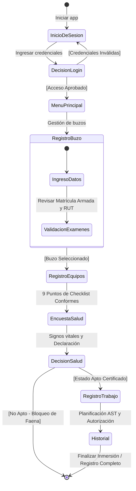

# 🌊 Aqua-Registro (MVP)

**Aqua-Registro** es una aplicación móvil nativa en Android diseñada para digitalizar y centralizar el pre-chequeo de seguridad de buzos comerciales en operaciones acuícolas (AquaChile), reemplazando los registros manuales en papel. Valida la identidad y matrícula del buzo, audita el equipamiento técnico obligatorio de buceo, evalúa parámetros biomédicos en la encuesta de salud y formaliza el Análisis Seguro de Trabajo (AST) para autorizar faenas submarinas.

---

## 🏗️ Arquitectura de Software: MVVM + UDF (Unidirectional Data Flow)

La aplicación sigue los principios de la arquitectura **MVVM (Model-View-ViewModel)** recomendada oficialmente por Android y Google:

```mermaid
graph TD
    subgraph UI ["Capa de Vista (Jetpack Compose)"]
        Screens["Screens (Login, Menu, Buzos, Equipos, Salud, Trabajo, Historial)"]
        Scaffold["AquaScaffold + ModalNavigationDrawer + SnackbarHost"]
    end

    subgraph ViewModel ["Capa de ViewModel (StateFlow)"]
        VM["ViewModels (Auth, Buzo, Equipos, Salud, Trabajo, Historial)"]
        UiState["UiState Data Classes (Inmutables)"]
    end

    subgraph Data ["Capa de Datos y Repositorio"]
        Repo["AquaRepository (Singleton con StateFlow)"]
        Models["Modelos de Dominio (Buzo, Prevencionista, EquipoChequeo, RegistroFaena)"]
    end

    Screens -->|Eventos de Usuario / Intents| VM
    VM -->|Actualiza / Emite| UiState
    UiState -->|StateFlow .collectAsState()| Screens
    VM -->|Llamadas a Casos de Uso / Métodos| Repo
    Repo -->|StateFlow Data Streams| VM
    Repo -->|Manipula modelos inmutables| Models
    Scaffold -->|Despliega Drawer y Notificaciones| Screens
```

### Componentes de la Arquitectura:
1. **Modelos de Datos (`data.model`):**
   * [`EstadoSalud`](file:///C:/Users/joaks/OneDrive/Documentos/codigo/Aqua-Registro/MyApplication/app/src/main/java/com/example/myapplication/data/model/EstadoSalud.kt): Enum con estados de aptitud médica (`APTO`, `NO_APTO`, `PENDIENTE`).
   * [`Buzo`](file:///C:/Users/joaks/OneDrive/Documentos/codigo/Aqua-Registro/MyApplication/app/src/main/java/com/example/myapplication/data/model/Buzo.kt): Entidad inmutable con matrícula DIRECTEMAR, RUT, empresa contratista y estado de salud.
   * [`Prevencionista`](file:///C:/Users/joaks/OneDrive/Documentos/codigo/Aqua-Registro/MyApplication/app/src/main/java/com/example/myapplication/data/model/Prevencionista.kt): Perfil profesional, acreditación SEREMI y base asignada.
   * [`EquipoChequeo`](file:///C:/Users/joaks/OneDrive/Documentos/codigo/Aqua-Registro/MyApplication/app/src/main/java/com/example/myapplication/data/model/EquipoChequeo.kt): Checklist de los 9 implementos técnicos obligatorios de buceo.
   * [`RegistroFaena`](file:///C:/Users/joaks/OneDrive/Documentos/codigo/Aqua-Registro/MyApplication/app/src/main/java/com/example/myapplication/data/model/RegistroFaena.kt): Acta digital de inmersión y faena AST.

2. **Repositorio Central (`data.repository`):**
   * [`AquaRepository`](file:///C:/Users/joaks/OneDrive/Documentos/codigo/Aqua-Registro/MyApplication/app/src/main/java/com/example/myapplication/data/repository/AquaRepository.kt): Administra los flujos reactivos `StateFlow` para usuarios, buzos, faenas y checklists por buzo.

3. **ViewModels y StateFlow (`ui.viewmodels`):**
   * Flujo unidireccional de datos con estados `StateFlow<UiState>` y funciones de intención (`Intent`).
   * [`AuthViewModel`](file:///C:/Users/joaks/OneDrive/Documentos/codigo/Aqua-Registro/MyApplication/app/src/main/java/com/example/myapplication/ui/viewmodels/AuthViewModel.kt): Autenticación y alta de prevencionistas.
   * [`BuzoViewModel`](file:///C:/Users/joaks/OneDrive/Documentos/codigo/Aqua-Registro/MyApplication/app/src/main/java/com/example/myapplication/ui/viewmodels/BuzoViewModel.kt): Enrolamiento, búsqueda y catálogo de buzos.
   * [`EquiposViewModel`](file:///C:/Users/joaks/OneDrive/Documentos/codigo/Aqua-Registro/MyApplication/app/src/main/java/com/example/myapplication/ui/viewmodels/EquiposViewModel.kt): Checklist interactivo y persistencia por buzo.
   * [`SaludViewModel`](file:///C:/Users/joaks/OneDrive/Documentos/codigo/Aqua-Registro/MyApplication/app/src/main/java/com/example/myapplication/ui/viewmodels/SaludViewModel.kt): Declaración de salud y dictamen biomédico.
   * [`TrabajoViewModel`](file:///C:/Users/joaks/OneDrive/Documentos/codigo/Aqua-Registro/MyApplication/app/src/main/java/com/example/myapplication/ui/viewmodels/TrabajoViewModel.kt): Planificación AST con validación estricta de aptitud médica.
   * [`HistorialViewModel`](file:///C:/Users/joaks/OneDrive/Documentos/codigo/Aqua-Registro/MyApplication/app/src/main/java/com/example/myapplication/ui/viewmodels/HistorialViewModel.kt): Bitácora, filtros por estado y cierre de inmersiones.

4. **Navegación y UI (`ui.navigation`, `ui.components`):**
   * **Navigation Compose:** Grafo de navegación tipado con [`Screen`](file:///C:/Users/joaks/OneDrive/Documentos/codigo/Aqua-Registro/MyApplication/app/src/main/java/com/example/myapplication/ui/navigation/NavRoutes.kt) en [`MainActivity.kt`](file:///C:/Users/joaks/OneDrive/Documentos/codigo/Aqua-Registro/MyApplication/app/src/main/java/com/example/myapplication/MainActivity.kt).
   * **ModalNavigationDrawer:** Menú lateral institucional ([`AquaDrawerContent`](file:///C:/Users/joaks/OneDrive/Documentos/codigo/Aqua-Registro/MyApplication/app/src/main/java/com/example/myapplication/ui/components/AquaDrawerContent.kt)) con perfil del prevencionista y acceso directo a todos los módulos.
   * **AquaScaffold:** Layout unificado con TopAppBar, botón hamburguesa, gestos táctiles y soporte de `SnackbarHost`.
   * **Snackbar:** Notificaciones reactivas en terreno ante validaciones, errores y confirmaciones operativas.

---

## 🎨 Identidad Visual (Material Design 3)
* **Principal:** Azul Claro (`#0099FF`) - Barras superiores, botones primarios y branding.
* **Secundario:** Verde Agua (`#00CCCC`) - Botones de acción afirmativa y acentos.
* **Fondo:** Blanco Hielo (`#F6F9FD`) - Reducción de fatiga visual bajo la luz solar marina.
* **Texto:** Slate Oscuro (`#111827`) - Contraste nítido.
* **Seguridad:** Verde Éxito (`#16A34A`) para *Apto*, Rojo Alerta (`#DC2626`) para *No Apto*.

---

## 🗺️ Flujo Operativo del Prevencionista


